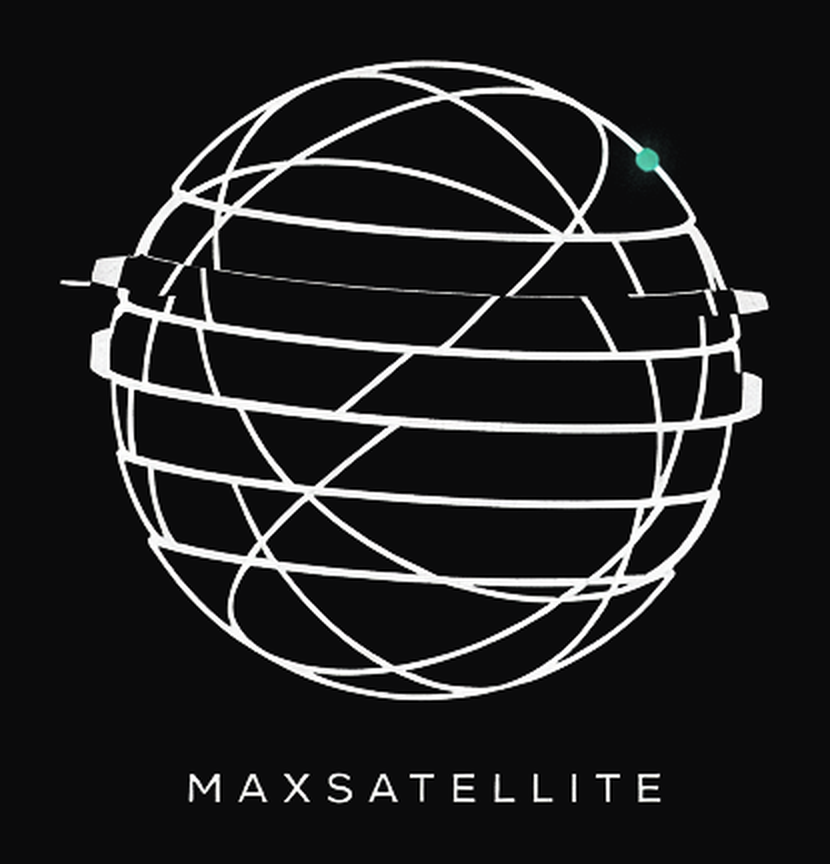
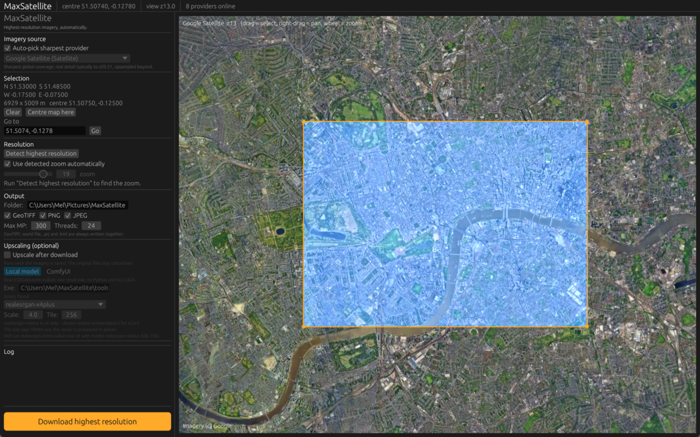

<p align="center">
  
</p>

**Satellite imagery at the highest resolution actually available — without the guesswork.**

Point MaxSatellite at an area and it finds which imagery source really delivers detail
there, *measures* the true native zoom instead of trusting the advertised maximum,
stitches the tiles into one mosaic, and writes georeferenced files.



## Why it exists

Tools like SAS.Planet make you match the zoom level by hand, then hand you
upsampled imagery that *looks* like detail and isn't. MaxSatellite measures the
difference: every candidate zoom is scored with a noise-suppressed Laplacian
variance — real detail scores **2.4–3.3**, upscaled filler scores **1.36–1.56**.
Past the measured ceiling it says so instead of quietly serving filler.

## What it does

- **Measures native zoom** per provider and per area — no manual matching.
- **Lists only providers that actually deliver** from your machine. Here (HTTP 410)
  and Yahoo (broken tile endpoint) are excluded rather than left to fail.
- **Georeferenced output by default**: GeoTIFF + world file + `.prj` (EPSG:3857),
  PNG + `.pgw`, JPEG + `.jpgw`, and a KML ground overlay.
- **Upscaling is a separate step attached to a download**, never baked into it —
  Real-ESRGAN locally, or your own ComfyUI graph. Originals stay untouched.
- **Takes place names**, not just coordinates: type a city and it geocodes the area
  bounding box, so "an image of Moscow" means the city, not a square around a point.
- **Drivable by an agent or LLM** through a local HTTP API.

## Running it

| What | How |
| --- | --- |
| The app | double-click `MaxSatellite.bat`, or `cargo run --release -- gui` |
| The API | double-click `serve-api.bat` (port 8791), or `maxsatellite serve` |
| One download | `maxsatellite download --place "Trafalgar Square" --zoom auto` |
| A place name | `maxsatellite lookup "Moscow"` |
| What a provider really has | `maxsatellite probe --place "Moscow"` |
| Upscale a result | `maxsatellite upscale --input out.png --backend local` |

Needs a stable Rust toolchain (edition 2021) and a GPU with Vulkan or DX12.
`cargo test` runs 44 tests. Output lands in
`C:\Users\<you>\Pictures\MaxSatellite\<name>_z<zoom>\`.

## The HTTP API — for agents and LLMs

```bash
maxsatellite serve                      # http://127.0.0.1:8791

curl -X POST "http://127.0.0.1:8791/images?wait=1" \
  -H 'Content-Type: application/json' \
  -d '{"place":"Moscow"}'
```

`place` is enough. `GET /` returns the whole API as JSON, including every
request-body field — the intended first call for a model, so it can discover the
surface itself. Other routes: `/geocode?q=`, `/providers`, `/jobs`,
`/jobs/<id>` (+`/log`, `/cancel`), and `/file?path=` which streams the bytes back.

Loopback only by default: this API fetches and writes files on your behalf, so
`--bind 0.0.0.0` puts it on the LAN deliberately rather than by accident.

**`zoom: "auto"` steps down to fit the budget** rather than failing, because the
measured ceiling is about *detail*, not size — Moscow at its true z20 is 251,709
MP. So "give me Moscow" produces the best Moscow that fits:

```
measured ceiling is z19 (251709 MP), too big for the 6 MP budget - using z11 (3.8 MP);
raise max_megapixels or pass a zoom to override
```

An explicit `zoom` is still obeyed exactly.

## Layout

```
src/geo.rs         web-mercator maths, bounding boxes, tile ranges
src/providers.rs   the provider catalogue and URL templates
src/fetch.rs       tile fetching, disk cache, retries
src/probe.rs       measuring the true native zoom
src/imageops.rs    mosaic, crop, detail scoring
src/geotiff.rs     GeoTIFF, world files, .prj, KML
src/download.rs    the download job itself
src/upscale.rs     optional Real-ESRGAN / ComfyUI upscale step
src/geocode.rs     place names (Nominatim)
src/api.rs         the HTTP API
src/app.rs         the egui GUI
src/cli.rs         the CLI
```

## Notes

- Imagery belongs to its providers — respect their terms of use and rate limits.
- Nominatim allows about one request a second, so lookups are user-triggered,
  never per keystroke.
- The upscaler binary (`tools/realesrgan-ncnn-vulkan/`) is not committed; drop it
  in and the upscale panel finds it automatically.
- Measured zooms are one machine's results on one day and vary by provider,
  region and time — the app re-measures rather than trusting a cache.
